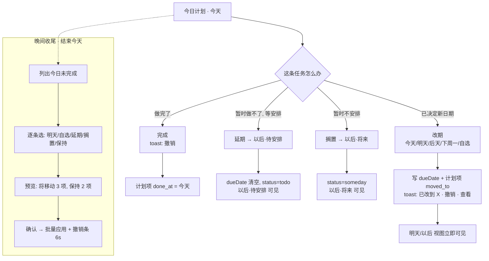
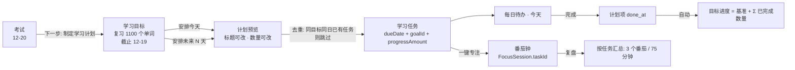
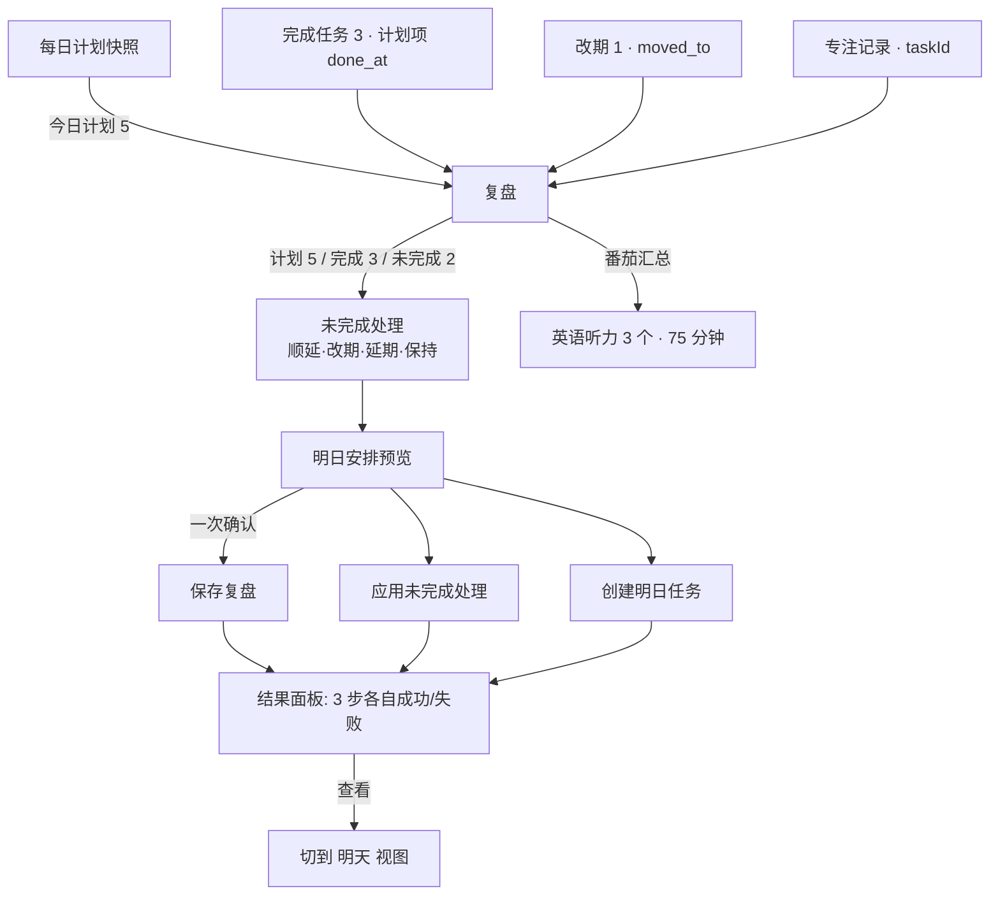

# v1.35–v1.37 迭代方案：每日计划 · 学习联动 · 复盘闭环

> 依据：委托书《个人工作台 v1.34.1｜移动端优先的每日计划、学习管理与复盘协同迭代委托书》+ 核对报告 [RESEARCH_2026-11-27_每日计划学习复盘现状核对.md](./RESEARCH_2026-11-27_每日计划学习复盘现状核对.md)。
> 状态：**待审阅**。批准前不改任何代码、不执行迁移、不部署。
> 基线：v1.34.1（HEAD `5a63621`）。

## 0. 一页结论

| 问题 | 本轮答案 |
|---|---|
| 改期后任务去哪了 | 新增「明天 / 以后」视图；改期有 toast + 撤销 + 「查看明天」；当天能核对 |
| 计划了几项、完成几项、剩几项 | 新增**每日计划快照**（1 张表），复盘直接读 5 / 3 / 2，历史不被后续改期覆盖 |
| 考试 → 目标 → 任务 | 3 个可空关联字段（`StudyGoal.examId` / `Task.goalId` / `Task.progressAmount`），**不新建任务系统** |
| 目标进度怎么涨 | 改为「手动基准 + 已完成关联任务量」的**账本式派生**，幂等、可撤销、不重复计数；展示口径不变 |
| 番茄钟归属 | `FocusSession.taskId` 可空 + 任务卡一键开专注 + 完成前选任务 |
| 移动端操作成本 | 新建从 10 个控件降到 1 个必填；卡片可点元素从 7 个降到 3 个；收尾从 15 次点击降到 5–7 次 |

**三个版本，三次上线，每次都可独立回滚：**

| 版本 | 主题 | 迁移 | 主要交付 |
|---|---|---|---|
| v1.35.0 | 计划基础与操作回执 | 019（1 张表） | 统一完成入口、计划快照、改期回执/撤销/明天视图、晚间收尾、删除确认、任务卡分层、新建任务简化 |
| v1.36.0 | 学习与任务联动 | 020（4 个可空列） | 考试详情、目标详情、计划生成预览（去重/撤销）、进度账本、番茄钟关联任务 |
| v1.37.0 | 复盘闭环 | 无 | 复盘重构（计划/完成/未完成/改期/专注明细）、未完成处理、明日安排一体化保存、历史计划查看 |

**为什么计划快照放第一阶段（而不是委托书的第三阶段）**：快照是"从今天开始记录"的数据，**无法回填**。v1.35 上线即开始积累，到 v1.37 做复盘 UI 时才有真实历史可看；反过来先做 UI，则上线当天所有历史都是空的，还要再等一个月。UI 可以晚，数据不能晚。

## 1. 范围

### 1.1 本轮做

1. 任务完成 / 改期 / 延期 / 搁置的语义与入口统一（P0+P1）。
2. 每日计划快照与"今日计划 / 已完成 / 未完成 / 已改期"口径。
3. 考试 ↔ 学习目标 ↔ 学习任务 ↔ 每日待办 的**可空关联**与生成预览。
4. 目标进度的账本式派生。
5. 番茄钟 ↔ 任务，复盘按任务汇总专注。
6. 移动端：任务卡分层、底部操作面板、新建任务、收尾、复盘、考试/目标详情。
7. 备份导出/导入覆盖新表、新字段；本地/云端双实现一致。

### 1.2 本轮不做（明确延期）

| 不做 | 原因 |
|---|---|
| 独立的"备考计划 / 学习单元"实体 | 现有 `StudyGoal` + `Task` 足够；多一层实体就要多一套 CRUD 与迁移，违反最简实现 |
| 任务拆分生成**独立任务行** | 会造出第二套任务系统（委托书 2.2 #4/#5）。拆分 = 复用清单条目（详见 §5.3） |
| 甘特图 / 日历月视图 / 周计划模板 | 与三个真实问题无关；手机上信息密度不可控 |
| 预计耗时字段与"计划量合理性评分" | 需要用户先填估算才有数据；本轮先用"计划数 / 完成数 / 实际专注"回答。见 §10 决策 4 |
| 提醒推送通道改造（SCT / PushPlus） | 独立议题，已有待办 |
| 组织 / 团队 / 权限 | 单用户产品 |
| 全站视觉改版 | 只改本轮涉及的 8 个界面 |

## 2. 三条业务流程

### 2.1 A：未完成任务 → 改期 / 延期 / 搁置 / 收尾



**关键规则**

1. 改期**不打开编辑弹窗**（保留 2 次点击），但必须有回执。
2. 「延期」与「改期」是两件事：延期不选日期，进「待安排」；改期一定落到某一天。
3. 「搁置」= 将来收件箱（`status=someday`），不提醒、不统计、不进复盘分母。
4. 收尾**默认"保持"**，不自动顺延（委托书 4.5）。
5. 批量操作先预览、后可撤销。

### 2.2 B：考试 → 学习目标 → 学习任务 → 每日待办



**关键规则**

1. 生成的学习任务就是普通 `Task`：同样的完成、改期、专注、复盘，不另立类型。
2. 标题由用户写，数量单独存（`progressAmount`），**不再拼接"推进 5"**。
3. 去重依据是数据（同目标 + 同日期 + 未完成），不是会话内 `useRef`。
4. 生成后可"撤销本次生成"（删除本批创建的任务），刷新后不可撤销但也不会重复生成。

### 2.3 C：每日计划 → 番茄执行 → 复盘 → 明日安排



**关键规则**

1. 统计一律基于**计划快照**，不按"当前 dueDate 反推"。
2. 三步写入按固定顺序执行，每步单独回显；失败时不停在"看起来成功"的状态（委托书 6.5）。
3. 「查看明日」带 `?day=tomorrow` 打开今日计划页的明天段，不再落到今天。

## 3. 核心规则（先定义，再实现）

### 3.1 完成语义（唯一入口）

```ts
// src/lib/task-rules.ts（保留，扩展）
isDoneForToday(t, today)      // 今日页分区用：普通任务 status=done；重复任务 completedAt 本地日=今天
completionPatch(t, today)     // 完成 → patch + undo（唯一算法，已存在）
reopenPatch(t, today)         // 撤销完成（已存在）
```

新增一条硬约束：**任何"完成"都必须走 `useCompleteTask()`**，禁止组件里写 `patch: { status: 'done' }`。该 hook 负责三件事：派生 patch、写计划项 `done_at`、弹带撤销的 toast。

### 3.2 日期与归属语义

| 状态 | 存储 | 出现在 | 进复盘分母 |
|---|---|---|---|
| 今天 | `dueDate=today, status=todo/doing` | 今天段 | 是（plan_date=today） |
| 明天 | `dueDate=tomorrow` | 明天段 | 否（明天才进） |
| 以后（有日期） | `dueDate > tomorrow` | 以后段（按日分组） | 否 |
| 待安排（延期） | `dueDate=null, status=todo` | 以后段 · 待安排 | 否 |
| 将来（搁置） | `status=someday, dueDate=null` | 以后段 · 将来 | 否 |
| 已完成 | `status=done / 重复任务 completedAt` | 已完成区（当天） | 计为已完成 |

`dueDate=null && status='todo'` 从"隐形"变为"待安排"，同时修掉 D-18。

### 3.3 计划快照口径（最重要的一条）

**定义：一条任务的"计划日" = 它当时的 `dueDate`。** 计划项以 `(plan_date, task_id)` 唯一。

| 指标 | 计算 |
|---|---|
| 今日计划 | `count(items where plan_date = D)` |
| 已完成 | `count(items where plan_date = D and done_at is not null)` |
| 未完成 | 计划 − 已完成 |
| 已改期 | `count(items where plan_date = D and moved_to is not null and done_at is null)` |
| 完成率 | 已完成 ÷ 计划（分母为 0 时不显示百分比） |
| 今日补完成 | `count(items where done_at::date = D and plan_date < D)`（单独一行小字，不混入 5/3/2） |

写入口径：

1. **物化**：进入今天段时，把 `dueDate=today`、`focusDate=today`、`status=doing` 的任务补成计划项（标题快照；已存在的不重复插）。
2. **完成**：`useCompleteTask` 以 upsert 写 `done_at = now`（计划项可能还没物化——用户可能一进页面就勾完成）；撤销写回 `null`。
3. **改期**：旧计划项写 `moved_to = 新日期`，新日期补一条计划项（标题快照）。
4. **删除**：计划项**不删**（标题快照保留，历史仍可读），任务侧消失。
5. **不覆盖历史**：任何进入"过去日期"的写入都只允许改 `done_at`（撤销场景），不改 `title / plan_date`。

### 3.4 目标进度口径（账本式）

字段语义调整（不加列）：`StudyGoal.progress` 从"当前进度"改为**手动基准**。

```ts
// 唯一公式
auto(g)     = Σ plan_items.amount  where goal_id = g.id and done_at is not null
display(g)  = clamp(g.progress + auto(g), 0, g.target)
// 手动 ±1/+5/精确输入
g.progress  = clamp(目标值 − auto(g), 0, g.target)   // 写回基准，展示结果 = 目标值
```

为什么这样能同时满足委托书 5.4 的 6 条：

| 要求 | 机制 |
|---|---|
| 唯一权威来源 | 基准（可写）+ 计划项（事实），展示值永远由二者派生 |
| 完成后推进 | 计划项 `done_at` 一写，展示值立即变 |
| 撤销不重复 | 撤销清空 `done_at`，派生值自动回退，不需要减操作 |
| 改期不影响 | 进度只看 `done_at`，不看 `dueDate` |
| 删除不错乱 | 计划项保留（任务删除不级联），历史贡献不丢 |
| 手动/自动不双算 | 手动改的是基准，自动部分永远重新派生 |

旧目标迁移：`progress` 原值即基准，`auto=0`（没有关联任务）→ 展示与今天完全一致，**零数据迁移**。若用户完成第一条关联任务后发现数字偏大，用"±"校准一次即可（等价于"以我为准"）。

## 4. 数据模型与迁移

### 4.1 变更总览

| 对象 | 变更 | 可空 | 迁移 | 用途 |
|---|---|---|---|---|
| 新表 `wb_plan_items` | 9 列 | — | 019 | 每日计划快照与完成事实 |
| `wb_tasks` | `goal_id text` | 是 | 020 | 学习任务归属目标 |
| `wb_tasks` | `progress_amount int` | 是 | 020 | 这条任务完成时推进多少 |
| `wb_study_goals` | `exam_id text` | 是 | 020 | 目标属于哪场考试 |
| `wb_focus_sessions` | `task_id text` | 是 | 020 | 专注归属任务 |

**不加的东西**：不建 `wb_study_tasks`、不建 `wb_exams_goals` 关联表、不加 `Task.type`、不加 `estimate_minutes`、不改 `status` 枚举。

### 4.2 `wb_plan_items`

| 列 | 类型 | 说明 |
|---|---|---|
| `user_id` | uuid | RLS 用；PK 之一 |
| `plan_date` | text | YYYY-MM-DD；PK 之一 |
| `task_id` | text | PK 之一；不做外键（任务删除后历史仍需可读） |
| `title` | text | 计划时的标题快照 |
| `goal_id` | text | 计划时若已关联目标则冗余存一份（任务被删也不丢目标归属） |
| `amount` | int | 计划时从 `Task.progressAmount` 快照；无目标则 null |
| `done_at` | timestamptz | 完成事实；可撤销 |
| `moved_to` | text | 改期目标日；撤销改期时清空 |
| `created_at` | timestamptz | 物化时间 |

主键 `(user_id, plan_date, task_id)` + 索引 `(user_id, plan_date)`。**为什么用行而不是 JSON 数组**：收尾会并发改 5 条，JSON 是"读-改-写"，必然丢更新；行级 upsert 天然幂等。

### 4.3 为什么不是"任务日期变更事件"或 `Task.plannedDate`

| 方案 | 能否回答"当天计划 5 项" | 重复任务按天计数 | 写入点 | 查询成本 | 结论 |
|---|---|---|---|---|---|
| 事件日志（append-only） | 需要回放全部事件，且要定义"当日开始"锚点 | 可以 | 每个写路径都要发事件（漏一个就永久错） | 高（回放 + 去重） | 否决：正确性依赖"不漏记"，最难验证 |
| `Task.plannedDate` 单列 | 不能：任务只有一行，改期后只剩最后一次 | 不能（一行多期） | 少 | 低 | 否决：恰好答不了委托书 6.3 的核心场景 |
| **每日计划行（采纳）** | 直接 count | 可以（一期一行） | 物化 + 完成 + 改期 3 处，且都集中在一个 hook | 低（一次范围查询） | 采纳 |

维护成本：一年约 3–4 千行（10 条/天），Supabase 无压力；本地模式按 §4.5 裁剪。

### 4.4 关联字段的语义

- `Task.goalId`：只在"由目标生成"或用户手动关联时写；**不通过标题反解历史**。
- `Task.progressAmount`：生成时写入建议量；手改任务时不动；无目标的任务为 `null`。
- `StudyGoal.examId`：从考试详情进入时自动写；考试可被删除（删后置 null）。
- `FocusSession.taskId`：自由专注为 `null`；**不从 note 猜任务**。

### 4.5 本地模式与备份

- 新表在本地是 `wb:planItems`（localStorage）。写入时顺手裁剪 `plan_date < today-400d` 的行，控制配额（D-22）。
- `BackupTables` 增加 `planItems`；导出与 `importAll` 同步。
- **不要把 planItems 加进 `validateBackup` 的必需表清单**：那个函数要求 `TABLE_KEYS` 里每张表都存在，加进去会让**所有旧备份文件被判 corrupt**。新表按"可选表"处理（缺失即空数组），必需表仍是原来的 12 张。
- **备份格式版本保持 1**：只加表、不改语义；旧文件仍可导入（新表为空），新文件导入旧版本会忽略多余表——不写兼容层，靠"缺表=空"这一条就够了。

### 4.6 迁移 SQL（草稿，批准后落文件）

```sql
-- 019_plan_items.sql（v1.35；需用户在场执行；先迁移后部署）
create table if not exists public.wb_plan_items (
  user_id uuid not null default auth.uid(),
  plan_date text not null,
  task_id text not null,
  title text not null,
  goal_id text,
  amount int,
  done_at timestamptz,
  moved_to text,
  created_at timestamptz not null default now(),
  primary key (user_id, plan_date, task_id)
);
create index if not exists wb_plan_items_user_date_idx on public.wb_plan_items (user_id, plan_date);
alter table public.wb_plan_items enable row level security;
drop policy if exists p_select_wb_plan_items on public.wb_plan_items;
create policy p_select_wb_plan_items on public.wb_plan_items for select using (user_id = auth.uid());
drop policy if exists p_insert_wb_plan_items on public.wb_plan_items;
create policy p_insert_wb_plan_items on public.wb_plan_items for insert with check (user_id = auth.uid());
drop policy if exists p_update_wb_plan_items on public.wb_plan_items;
create policy p_update_wb_plan_items on public.wb_plan_items for update using (user_id = auth.uid());
drop policy if exists p_delete_wb_plan_items on public.wb_plan_items;
create policy p_delete_wb_plan_items on public.wb_plan_items for delete using (user_id = auth.uid());
```

```sql
-- 020_study_links.sql（v1.36）
alter table public.wb_tasks add column if not exists goal_id text;
alter table public.wb_tasks add column if not exists progress_amount int;
alter table public.wb_study_goals add column if not exists exam_id text;
alter table public.wb_focus_sessions add column if not exists task_id text;
```

**注意**：现有 001/006 的 `create policy` 没有 `drop ... if exists`，重跑会报错；新迁移按上面的写法做到真正幂等，并在 `tests/migrations.test.ts`（新增）里断言"同一段 SQL 解析两次得到相同列/策略集合"。

### 4.7 删除联动

| 删除 | 处理 | 双端一致 |
|---|---|---|
| 删任务 | 计划项保留（历史）；若任务是本批生成的，可从"撤销生成"里恢复 | 是 |
| 删目标 | 关联任务的 `goalId` 置 null（不删任务） | 是，契约测试 |
| 删考试 | 关联目标的 `examId` 置 null | 是，契约测试 |

## 5. 移动端页面方案

> 设计基准 360–430px；320/375/390/430 逐档验收。所有主操作触控区 ≥ 44×44；底部浮层留 `env(safe-area-inset-bottom)`；键盘弹出时主按钮不被遮挡。

### 5.1 每日计划页（`/tasks`）——三段视图

```text
┌─────────────────────────────┐
│ 今日计划           [收尾]   │
│ 今天 5 · 完成 3 · 剩余 2     │
├─────────────────────────────┤
│ [今天 5] [明天 2] [以后 3]   │  ← 分段控件（44px 高，带计数）
├─────────────────────────────┤
│ ⚠ 已逾期 1 项  全部顺延→     │
│ ┌─────────────────────────┐ │
│ │○ 读论文并回执报告     ⋯ │ │
│ │  叶建梅老师 · 学习      │ │
│ └─────────────────────────┘ │
│ ┌─────────────────────────┐ │
│ │✓ 准备英语演讲（划线） ⋯ │ │
│ └─────────────────────────┘ │
│ 已完成 3 项 · 点勾撤销  ▾    │
└─────────────────────────────┘
   [今天] 段 = 今日到期 + 今日焦点 + 进行中 + 逾期 + 已完成
   [明天] 段 = 明天到期（主操作: 移回今天 / 改期）+ 未来 7 天分组
   [以后] 段 = 更远日期 + 待安排（无日期待办）+ 将来（搁置）
```

- 首屏：分段控件 + 计数 + 逾期提示 + 前 3 张卡；不放大标题副文案。
- 主操作：勾选完成（1 次点击）；卡片 ⋯ 打开操作面板（1 次点击）。
- 空态：今天段空 → "今天没有安排 · 从明天移一条过来 / 新建"；明天段空 → "明天还是空的"。
- 加载：2 行骨架；错误：一行"加载失败，重试"。
- 320px：分段控件三等分，字号 12px；卡片标题 2 行截断。
- 查询参数：`/tasks?day=tomorrow` 直接落到明天段（复盘「查看」用）。

### 5.2 任务卡 v2（分层）

```text
┌──────────────────────────────────┐
│▎ ○  准备英语演讲           ⭐ ⋯ │  ← 层1: 勾选 / 标题 / 焦点 / 唯一操作入口
│     每天 · 学习 · 清单 0/2        │  ← 层2: 最多 3 个徽章 + 归属
│     一定要记住啊（1 行）          │  ← 层2: 备注摘要
└──────────────────────────────────┘
  ▎=左侧 3px 状态轨（优先级/紧急度，颜色不是唯一载体，读屏有文字）
  删除/改期/清单箭头/星标按钮全部收进 ⋯ 面板
  拖动把手只在「今天」段显示，位于勾选框左侧，24×44 触控区
```

对比：可点元素 7 → 3（勾选、标题、⋯）；右侧控件宽度从约 96px 降到 44px，标题可用宽度 +12%。

### 5.3 任务操作面板（底部 Sheet）

```text
┌─────────────────────────────┐
│ 准备英语演讲            ✕   │
│ 今天 · 学习 · 每天           │
├─────────────────────────────┤
│ [✓ 完成]  [⏱ 专注 25 分钟]   │  ← 两个主操作，各占一半
├─────────────────────────────┤
│ 改期                        │
│ [今天][明天][后天][下周一]   │
│ [自选日期 2026-11-29 ▾]     │
├─────────────────────────────┤
│ 延期（不排期，进“待安排”）   │
│ 搁置（进“将来”）             │
│ 拆分 → 转成清单条目          │
│ 编辑                        │
│ 删除                     ⌫  │  ← 红色文字，二次确认
└─────────────────────────────┘
```

- 「拆分」= 把这条任务转成带清单条目的任务（复用 `checklist`），**不新建任务行**；理由：清单已经能表达"大任务拆成可勾的小步"，再建独立任务会造成两套任务（委托书 2.2 #4）。
- 删除 → 确认弹层（"删除「标题」？" + 删除/取消），删除后 toast 撤销 6s。
- 自选日期：原生 `input[type=date]`，禁止早于今天（过去日期提示"已过期，改到今天？"）。

### 5.4 新建 / 编辑任务（底部 Sheet）

```text
┌─────────────────────────────┐
│ 新建任务                ✕   │
│ ┌─────────────────────────┐ │
│ │ 要做什么？              │ │  ← 自动聚焦，唯一必填
│ └─────────────────────────┘ │
│ 日期  [今天][明天][自选]     │  ← 默认今天
│ 更多设置 ▾（备注/优先级/重复/时间/标签/状态）│
├─────────────────────────────┤
│        [ 添加 ]             │  ← 吸底，键盘上方可见
└─────────────────────────────┘
```

- 编辑态：标题 + 日期常显，其余同折叠；"保存"吸底。
- 桌面端（≥768px）用居中 Dialog，同一套表单组件（`TaskForm`），不写两份。
- 状态 pills 保留三态语义，但"将来"并入"延期/搁置"的说明文案，避免 D-18 再产生隐形任务。

### 5.5 收尾（结束今天）

```text
┌─────────────────────────────┐
│ 结束今天 · 还有 4 项没完成   │
│ 逐条选择去向，默认“保持”     │
├─────────────────────────────┤
│ 读论文并回执   [保持][明天][延期][搁置] │
│ 写回执         [保持][明天][延期][搁置] │
├─────────────────────────────┤
│ 将移动 2 项 · 延期 1 项 · 保持 1 项        │
│ [全部设为明天]  [确认]  [取消]             │
└─────────────────────────────┘
```

- 入口：今天段顶部「收尾」（20:00 后高亮）+ 复盘页「未完成处理」。
- 确认后应用并显示撤销条（6s，逐条还原原 dueDate/status）。
- "全部设为明天"是**二次操作**，不是默认。

### 5.6 考试详情（`/study/exam/:id`）

```text
┌─────────────────────────────┐
│ ← 期末考试                  │
│ 12 月 20 日 · 23 天后 · 英语 │
│ 备注……                      │
├─────────────────────────────┤
│ 备考目标 2                  │
│ · 复习 1100 个单词  620/1100 │
│ · 真题 10 套        3/10     │
├─────────────────────────────┤
│ [为这场考试制定学习计划]     │  ← 开目标弹窗，预填 examId + 截止 12-19
│ [编辑考试] [删除]           │
└─────────────────────────────┘
```

### 5.7 学习目标详情 + 计划生成预览（`/study/goal/:id`）

```text
┌─────────────────────────────┐
│ ← 复习 1100 个单词           │
│ 进度 620 / 1100（自动 +48）  │
│ 截止 12-19 · 剩 23 天        │
│ 建议每天 21（剩余 480 / 23） │
├─────────────────────────────┤
│ [安排今天]  [安排未来几天]    │
├─────────────────────────────┤
│ 关联任务（按日）             │
│ 11-27 复习第三章词汇 · 已完成│
│ 11-28 复习第四章词汇         │
└─────────────────────────────┘
         ↓ 安排未来几天
┌─────────────────────────────┐
│ 预览 · 未来 3 天             │
│ 11-28 [复习第三章词汇] 21    │
│ 11-29 [复习第四章词汇] 21    │
│ 11-30 [复习第五章词汇] 20    │
│ + 添加另一条学习任务          │
│ 已存在 1 条，将跳过           │
│ [确认生成 3 条]  [取消]       │
└─────────────────────────────┘
```

- 建议量 = `ceil(剩余 / 剩余天数)`，最后一天取余数，保证总和准确。
- 标题默认取目标名，可逐条改；数量单独编辑。
- 去重：同目标 + 同日 + 未完成 → 标"已存在，跳过"。
- 生成后结果面板列出本批任务，支持"撤销本次生成"（删除这批）。

### 5.8 复盘 v2（`/review`）

```text
┌─────────────────────────────┐
│ 今日复盘            连续 7 天 │
│ 11 月 27 日 · 周四           │
├─────────────────────────────┤
│ 计划 5 · 完成 3 · 未完成 2   │  ← 一行说清，替代“累计 68”
│ 完成率 60%  ▓▓▓▓▓▓░░░░       │
│ 改期 1 · 搁置 0（点开看明细） │
├─────────────────────────────┤
│ ① 未完成处理   [处理 2 项 →] │
│ ② 今日专注                   │
│    英语听力 3 个 · 75 分钟   │
│    数学真题 1 个 · 25 分钟   │
│    未关联 1 个 · 25 分钟     │
│ ③ 心情 / 评分                │
│ ④ 今日总结（折叠）           │
│ ⑤ 明日安排  [预览 3 条 →]    │
│ ⑥ [保存复盘并应用]           │
└─────────────────────────────┘
```

- 纵向分区，不照搬桌面双栏；首屏就是 5/3/2。
- 统计跟随 `activeDate`（修 D-16）；"本周回顾/趋势"标注"以今天为基准"。
- 保存按钮只有一处，但内部按 §2.3 的顺序执行并逐步回显。

### 5.9 番茄钟选任务

- 从任务卡「专注」进入：预选该任务，计时开始即绑定 `taskId`。
- 自由进入：开始前可选"关联今日任务"（顶部一行 chips），也可不选。
- 完成时若 `taskId` 存在，专注记录带 taskId + 任务标题快照（防止任务改名后复盘对不上）。

### 5.10 操作成本对照

| 场景 | 现状 | 目标 | 变化 |
|---|---|---|---|
| 完成 1 项 | 1 次点击 | 1 次点击 | 持平（但入口统一，重复任务不再出错） |
| 改到明天 | 2 次点击 + 无反馈 + 不可撤销 | 2 次点击 + toast（撤销/查看） | 点击持平，可逆性从 0 → 1 |
| 改到自选日 | 3 次点击（下拉里的小日期框） | 3 次点击（底部面板原生选择器） | 触控区 28px → 44px |
| 查看明天的任务 | 不可能 | 1 次点击（分段） | 从 ∞ → 1 |
| 新建任务（只填标题） | 3 次点击 + 1.6 屏表单 | 2 次点击 + 1 个输入框 | 控件 10 → 1（必填） |
| 晚间处理 5 项 | ≥15 次点击（逐条进菜单） | 5–7 次点击（逐条选 + 确认） | 约 −60%，且有预览与撤销 |
| 复盘看 5/3/2 | 不可能 | 0 次（自动） | 新能力 |
| 目标 → 今日任务 | 3 次点击，生成量错误 | 2 次点击 + 预览 | 且生成量正确、可撤销 |
| 番茄归属任务 | 手输主题，无法统计 | 1 次点击（卡片「专注」） | 新能力 |

## 6. 分阶段任务拆解

> 每项都写：改哪些文件 / 关键改动 / 测试 / 验收。P0 = 必须在本阶段完成；P1 = 同版本内尽力；P2 = 记录不排期。

### 6.1 第一阶段 · v1.35.0（计划基础与操作回执）

| # | 优先级 | 任务 | 文件 | 测试 | 验收 |
|---|---|---|---|---|---|
| 1.1 | P0 | 统一"完成"入口：新增 `useCompleteTask` / `useReopenTask`，替换三处直写 | 新 `modules/overview/use-task-actions.ts`；`daily-summary.tsx` `today-tasks.tsx` `reminders-center.tsx` | `tests/task-completion.test.ts`（重复任务不被终结、daily-summary 勾选走规则） | 汇总弹窗勾掉"每天"任务后，次日仍出现 |
| 1.2 | P0 | 计划快照：类型 + 双仓储 + 备份 + 迁移 019 | `lib/db/types.ts`、`local-repository.ts`、`supabase-repository.ts`、`lib/backup.ts`、`supabase/migrations/019_plan_items.sql` | `tests/day-plan.test.ts`、`repository-contract.test.ts` 增用例 | 导出含 planItems；双端行为一致 |
| 1.3 | P0 | 计划物化与统计纯函数 | 新 `lib/day-plan.ts` | `day-plan.test.ts`：物化幂等、改期 moved_to、撤销 done_at、保留 400 天 | 同一天重复进入页面不产生重复行 |
| 1.4 | P0 | 三段视图 + 改期回执/撤销 | `today-tasks.tsx`、`task-item.tsx` | e2e：改期 → toast → 撤销 → 回来；明天段可见 | 改期后 1 次点击可核对 |
| 1.5 | P0 | 收尾 Sheet（批量预览 + 撤销） | 新 `modules/overview/evening-wrap-up.tsx` | `tests/evening-wrap-up.test.tsx` | 5 项 ≤7 次点击处理完，撤销可还原 |
| 1.6 | P0 | 删除确认 + 6s 撤销（含 `restoreTask`） | `task-item.tsx`、双仓储 | 契约测试：restore 保留 id | 误删可 1 次点击恢复 |
| 1.7 | P1 | 任务卡 v2 + 操作面板 Sheet | `task-item.tsx`、新 `task-actions-sheet.tsx` | `task-card.test.ts` + 390px 截图 | 卡上可点元素 ≤3，触控 ≥44px |
| 1.8 | P1 | 新建任务 Sheet（`TaskForm` 抽取 + 吸底按钮） | `task-dialog.tsx` → `task-form.tsx` + 响应式外壳 | `task-dialog.test.tsx` 更新 | 只填标题 2 次点击完成 |
| 1.9 | P1 | `dueDate=null && todo` 归入"待安排"（修 D-18） | `api.ts`、`today-tasks.tsx` | 单测：不再不可见 | 清空日期后任务在"以后"可见 |
| 1.10 | P1 | 复盘统计跟随 `activeDate`（D-16）+ 汇总/首页口径统一（D-02/D-25） | `review.tsx`、`review-summary.ts`、`overview-home.tsx` | `review-summary.test.ts` 扩展 | 切历史日期数字跟着变 |
| 1.11 | P1 | 移动端收尾：FAB 让位、`window.confirm` 换 Sheet、安全区 | `layout.tsx`、`today-tasks.tsx` | 320/360/390/430 四档截图 | FAB 不压卡片操作区 |

**提交拆分**：`fix(overview): 统一任务完成入口` → `feat(overview): 每日计划快照与统计口径` → `feat(overview): 改期回执与明天/以后视图` → `feat(overview): 晚间收尾与删除撤销` → `feat(ui): 任务卡分层与移动端表单` → `docs: ...`。

### 6.2 第二阶段 · v1.36.0（学习联动）

| # | 优先级 | 任务 | 文件 | 测试 | 验收 |
|---|---|---|---|---|---|
| 2.1 | P0 | 关联字段 + 迁移 020 + 双端映射 + 备份 | `types.ts`、双仓储、`020` | 契约测试（新增字段往返） | 旧数据字段为 null 不报错 |
| 2.2 | P0 | 目标详情页 + 考试详情页 + 路由 | 新 `modules/study/goal-detail.tsx`、`exam-detail.tsx`、`App.tsx` | 组件测试 + 返回键 e2e | 从考试 1 次点击进详情 |
| 2.3 | P0 | 计划生成预览（建议量/去重/撤销） | 新 `lib/study-plan.ts`、`plan-preview.tsx` | `study-plan.test.ts`：余数分配、去重、撤销 | 生成 3 条与建议量一致，刷新不重复 |
| 2.4 | P0 | 进度账本（派生 + 手动校准 + 自动标记） | `lib/study-progress.ts`、`goal-manager.tsx` | `study-progress.test.ts`：撤销/删除/改期不变 | 完成关联任务 → 进度只涨一次 |
| 2.5 | P1 | 番茄钟关联任务（选择器 + 卡片一键） | `pomodoro.tsx`、`lib/pomodoro.ts`、`study/api.ts` | `pomodoro.test.ts` 扩展 | 完成专注后记录带 taskId |
| 2.6 | P1 | 考试→目标预填（examId/截止日） | `goal-manager.tsx`、`exam-dialog.tsx` | 组件测试 | 从考试进入不再重复填日期 |
| 2.7 | P2 | 目标排序/筛选、学习任务按目标分组视图 | — | — | 本轮不做 |

### 6.3 第三阶段 · v1.37.0（复盘闭环）

| # | 优先级 | 任务 | 文件 | 测试 | 验收 |
|---|---|---|---|---|---|
| 3.1 | P0 | 复盘统计改为计划快照口径 | `lib/review-summary.ts` | `review-summary.test.ts` 重写 | 5/3/2 与真实数据一致 |
| 3.2 | P0 | 复盘页纵向分区重构（移动优先） | `review.tsx` | 组件测试 + 390px 截图 | 首屏出现 5/3/2 |
| 3.3 | P0 | 未完成处理复用收尾 Sheet | `review.tsx`、`evening-wrap-up.tsx` | e2e：处理 2 项 → 明天段可见 | 处理后统计变 3/3/0 |
| 3.4 | P0 | 明日安排 + 保存复盘一体化（分步回显） | `review.tsx` | e2e：生成 + 保存 → 刷新后复盘仍在 | 不允许"任务成功但复盘丢失" |
| 3.5 | P0 | 专注按任务汇总（含未关联） | `lib/review-summary.ts`、`review.tsx` | 单测 | 英语听力 3 个 / 75 分钟 |
| 3.6 | P1 | 「去待办查看」→ `/tasks?day=tomorrow` | `review.tsx`、`today-tasks.tsx` | e2e | 点了就能看到刚生成的任务 |
| 3.7 | P1 | 历史计划明细（某日的计划项展开） | `review.tsx`、`lib/day-plan.ts` | 单测 | 11-20 的计划不被 11-27 的改期影响 |

## 7. 提交、发版与部署顺序

| 阶段 | 顺序 | 说明 |
|---|---|---|
| 每个 commit 前 | `npm test` 全绿 + `npm run build` + `npm run lint` ≤ 12 警告 | 按 AGENTS 5/5b；本地长命令用 `Start-Process` 后台跑（见 AGENTS 5c） |
| 阶段一上线 | ① 你执行 019 → ② 部署 v1.35.0 → ③ 真机验证 | 代码会写新表，**迁移必须先执行** |
| 阶段二上线 | ① 你执行 020 → ② 部署 v1.36.0 | 同上 |
| 阶段三上线 | 直接部署 v1.37.0 | 无迁移 |
| 版本号 | 1.35.0 / 1.36.0 / 1.37.0（feat 主导，minor） | 24h 内补丁并入当前 minor |

## 8. 测试与验收

### 8.1 新增/改动的自动化测试

| 类型 | 文件 | 断言 |
|---|---|---|
| 纯函数 | `tests/day-plan.test.ts` | 物化幂等、改期 moved_to、撤销 done_at、400 天裁剪、补完成归当日 |
| 纯函数 | `tests/study-plan.test.ts` | 建议量、余数分配、去重、撤销批 |
| 纯函数 | `tests/study-progress.test.ts` | 完成 +1 次、撤销不重复、改期不变、删除保留、手动校准 |
| 规则 | `tests/task-completion.test.ts` | 四类入口都走 `completionPatch`；重复任务不被终结 |
| 契约 | `tests/repository-contract.test.ts` | 计划项 CRUD、restoreTask、关联字段往返、删除联动 |
| 迁移 | `tests/migrations.test.ts`（新） | 019/020 可重复解析；策略与列名集合稳定 |
| 组件 | `tests/evening-wrap-up.test.tsx` | 默认保持、预览计数、撤销还原 |
| E2E | `e2e/smoke.spec.ts` 扩展 | 改期→撤销→明天段；收尾 5 项；复盘 5/3/2；生成→查看；重复任务跨日 |

**已知会红的旧断言**（必须同步改，不允许"改测试迁就实现"）：`今日 N 项` 文案、`已完成 N 项 · 点方块可撤销`、`去待办查看` 的落点、任务卡上的 `删除` 直接可见性。改之前先确认新文案的产品含义。

### 8.2 移动端验收矩阵

| 宽度 | 检查项 |
|---|---|
| 320 | 分段控件不折行；卡片标题 2 行；操作面板不横向溢出 |
| 360 | 主按钮 ≥44px；收尾 Sheet 四个去向按钮一行放得下 |
| 375 | 复盘首屏 5/3/2 完整可见；时间数字不换行 |
| 390 | 键盘弹出时"添加"仍然可见（视口缩到约 500px 高） |
| 430 | 卡片右侧 ⋯ 不被 FAB 压住；安全区留白 |

每档留 1 张截图，命名 `v135-<页面>-<宽度>.png`，放在 `docs/screenshots/v135/`（不进构建产物）。

### 8.3 验收口径（Definition of Done 对照）

- 任务操作：完成可撤销 ✓、改期有反馈 ✓、改期可撤销 ✓、当天可核对 ✓、自选日期校验 ✓、删除防误触 ✓、重复任务仍推进 ✓、所有完成入口同规则 ✓、收尾不静默丢任务 ✓。
- 学习联动：考试↔目标 ✓、目标↔任务 ✓、任务可在待办执行 ✓、完成反馈进度 ✓、撤销不重复 ✓、生成有预览/去重/撤销 ✓、手改不被覆盖 ✓。
- 复盘：当天计划/完成/未完成 ✓、历史不被改期覆盖 ✓、重复任务按天 ✓、番茄数量与分钟 ✓、按任务汇总 ✓、明日计划真正进入明天 ✓、复盘可靠保存 ✓。
- 技术：tsc/lint/test/build 全绿；契约一致；迁移幂等；备份兼容；无缓存不一致（每个写路径都 invalidate 计划项 queryKey）。

## 9. 风险、取舍与回滚

| 风险 | 影响 | 对策 |
|---|---|---|
| 计划项物化漏写 | 复盘分母偏小 | 物化是一个纯函数 + 一个 hook，只在 tasks 数据变化时跑；复盘打开时再跑一次"对账"补齐（只补不删） |
| 收尾并发写 5 条 | 部分失败 | 逐条 mutation + 汇总结果面板；失败条目保留原状并列出来 |
| 本地 localStorage 配额 | 写入失败 | 400 天裁剪；写入 catch 后提示"本地空间不足，请先导出备份" |
| 中途刷新导致撤销失效 | toast 消失 | toast 6s 只是快捷撤销；真正的兜底是「明天/以后」视图能改回来 |
| 迁移与部署顺序错 | 云端写入报 PGRST204 / PGRST205 | 迁移先行；新字段**条件写入**（与 v1.24 note 同款）；计划项同步包在 try/catch 里，表不存在时**静默降级**（今日页照常可用，复盘显示"从 v1.35 起记录"），不阻塞主流程 |
| 旧备份导入 | 新表缺失 | `?? []` 守卫；导入后计划项为空，复盘显示"从 v1.35 起记录" |
| 进度数字跳变 | 用户不信任 | 旧目标 `auto=0`，展示不变；新增"自动 +N"小字明示来源；± 即校准 |
| 测试大面积改文案 | 回归风险 | 先改断言再改实现（TDD 顺序），E2E 逐个跑通，不批量 sed |

回滚：代码回滚用 `git revert` 或回退 Vercel 部署（`pre-v1.35` tag 已存在）；数据库只加不删，回滚后新表/新列闲置，不影响旧版本运行。**不做 down migration**（符合"不保留向后兼容"，且删列会丢数据）。

## 10. 请你确认的 5 个决策

1. **底部导航是否调整？** 我建议**不动 6 个 Tab**，只把「今日待办」卡片提到首页第一位 + 今日页顶部加「收尾 / 复盘」入口。备选：换成 5 Tab（工作台 / 今日 / 学习 / 复盘 / 我的），热点/健康/成长只留首页宫格。**这条会改变你每天的第一屏，必须你点头。**
2. **「延期」与「搁置」的定义**：延期 = 无日期、进"待安排"（以后可排期）；搁置 = 进"将来"收件箱、不提醒不统计。是否符合你的用法？（这是我为了避免新增状态枚举做的映射）
3. **计划快照从 v1.35 开始记录**，更早的历史无法回溯（只能按当前任务状态近似）。接受吗？
4. **预计耗时**本轮不做（委托书 6.2 里有），因为没有估算数据时它只是噪声。要不要在任务面板加一个"预计 15/25/45 分钟"的轻量字段？加的话我把它放进 020 迁移。
5. **拆分 = 清单条目**（不生成独立任务）是否符合预期？如果你要的是"拆成 3 条各自能排期的任务"，我需要另设计父子任务字段，工作量 +1 个版本。

---

**批准方式**：回复"按方案执行"或指出要改的条目。批准后我按 §7 的顺序推进，每个阶段结束给你：修改文件清单、核心变更、迁移情况、测试结果、移动端截图、遗留问题、下一阶段计划。
